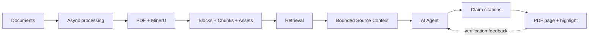

# Traceable RAG

<p align="center">
  
</p>

<p align="center">
  Help AI agents trace key claims back to the exact PDF page and highlighted source region.
</p>

<p align="center">
  <a href="README.zh-CN.md">简体中文</a>
  ·
  <a href="docs/getting-started.md">Getting started</a>
  ·
  <a href="docs/api.md">API</a>
  ·
  <a href="CONTRIBUTING.md">Contributing</a>
</p>

<p align="center">
  <a href="LICENSE"></a>
  <a href="https://github.com/yo-solo/traceable-rag/releases/latest"></a>
  <a href="https://github.com/yo-solo/traceable-rag/actions/workflows/ci.yml"></a>
  
  
</p>

Traceable RAG is an evidence retrieval service for external AI agents such as Codex. It ingests layout-rich documents, returns knowledge-base-scoped source candidates, exposes only bounded surrounding context, and gives every result a stable verification page with the original PDF page and region highlighted.

The server deliberately does not write the final answer. The agent keeps control of question decomposition and synthesis while Traceable RAG keeps the evidence boundary explicit and auditable.


## Why it exists

Most RAG demos stop at a plausible paragraph and a filename. Traceable RAG keeps going until a reader can inspect the exact source region.

- **Claim-level verification** — every useful candidate includes a `source_url` that opens the original page and highlight.
- **Bounded evidence access** — agents fetch a small amount of adjacent content only when a definition, table header, exception, or unit is missing.
- **Layout-aware processing** — PDF, DOCX, and common image uploads flow through asynchronous conversion, MinerU parsing, normalized blocks, chunks, and assets.
- **Visible degradation** — responses report the actual retrieval pipeline and structured warnings when embedding or reranking is unavailable.
- **Agent-first contract** — one query per Retrieval request, explicit knowledge-base scope, predictable 404/410 Source lifecycle, and a bundled Codex Skill.
- **Local security defaults** — loopback binding, non-root containers, exact release digests, and AES-256-GCM-encrypted Provider secrets.

## Linux quickstart

You need Docker Engine and Docker Compose v2 on Linux `amd64` or `arm64`. Install the exact `v0.5.0` release:

```bash
curl -fsSL https://github.com/yo-solo/traceable-rag/releases/download/v0.5.0/install.sh | sh
```

The installer verifies the release manifest and bundle checksum, pins the accepted multi-architecture image by digest, runs it as your non-root UID/GID, and binds only to `127.0.0.1:8000`. It creates isolated data directories plus local-only admin and encryption secrets. When the health check passes, open [http://127.0.0.1:8000](http://127.0.0.1:8000).

Configure MinerU and, optionally, Embedding and Reranker providers on the setup page. Provider keys are entered in the browser, encrypted before persistence, and never written to the deployment environment file.

Then create a knowledge base and upload the four licensed public samples from [`examples/vidore/documents`](examples/vidore/documents). They cover a process diagram, source code, a cross-page table, multi-column text, footnotes, and statistical charts. No private project document is included.

Try these questions:

- What stages does a compiler use, and what happens in the middle end?
- How do hierarchical and multiple inheritance differ in the comparison table?
- How did EU income inequality change after the 2014–15 peak?
- What does the chart show about gender segregation in future-oriented occupations?

Release assets, SBOMs, checksums, and the immutable image manifest are available on the [`v0.5.0` release page](https://github.com/yo-solo/traceable-rag/releases/tag/v0.5.0). The public image is `ghcr.io/yo-solo/traceable-rag-public`; installers consume its exact digest, never `latest`.

For source development instead, clone the repository and run `./scripts/deploy_local.sh`. See [Getting started](docs/getting-started.md) for checksum-first installation, Windows PowerShell, custom ports, and lifecycle commands.

## The verification loop

1. An agent discovers the service and selects one or more knowledge bases.
2. It decomposes the question into concrete evidence needs.
3. It calls `POST /api/retrieval` in `auto` or `keyword` mode.
4. It judges relevance separately from context completeness.
5. It calls `GET /api/sources/{source_id}/context` only for a specific missing detail.
6. It writes the answer with a Source link beside each material claim.
7. A reader opens the link and sees the original PDF page and highlighted region.

<details>
<summary>Exact code-native architecture</summary>



</details>

## API in two calls

Retrieval always has an explicit knowledge-base scope.

```bash
curl -s http://127.0.0.1:8000/api/retrieval \
  -H 'Content-Type: application/json' \
  -d '{
    "query": "How did EU income inequality change after the 2014–15 peak?",
    "knowledge_base_ids": ["YOUR_KB_ID"],
    "mode": "auto",
    "top_k": 8
  }'
```

A result reports `pipeline_used`, degradation state, candidate text, document name, 1-based page number, score, and a stable `source_id` / `source_url`. Scores rank candidates; they do not prove correctness or sufficiency.

Fetch limited adjacent material only when needed.

```bash
curl -s 'http://127.0.0.1:8000/api/sources/SOURCE_ID/context?before=2&after=2'
```

The current public contract is Retrieval → optional Source Context → Source links. Legacy `/api/query`, `/api/evidence/*`, and `/api/traces/*` routes intentionally return 404.

## Provider boundaries

| Role | Needed for | Supported boundary | Failure behavior |
|---|---|---|---|
| MinerU | Parsing uploaded documents | Official MinerU adapter | Processing job fails visibly and can be retried |
| Embedding | Dense retrieval and indexing | OpenAI-compatible or SiliconFlow | Retrieval degrades to keyword when safe |
| Reranker | Higher-quality candidate ordering | SiliconFlow/Qwen, Cohere, or Jina adapters | Retrieval falls back to dense candidates |
| LLM | Optional diagnostics or external workflows | OpenAI-compatible or SiliconFlow | Not required for the core retrieval service |

Each role has its own protocol, base URL, model, secret, options, and diagnostic state. Changing an embedding configuration is treated as an index compatibility event. The bundled service does not silently reuse incompatible vectors.

## What is tested

The repository includes backend contracts, frontend unit tests, browser E2E tests, release-identity checks, installer recovery tests, and a public-snapshot gate that rejects private sample paths and unexpected artifacts.

The current reproducible retrieval result uses the ViDoRe V3 Finance EN split, 309 queries, page-level qrels, and the official `pytrec_eval` metric contract.

| Pipeline | nDCG@10 | Recall@10 | Recall@100 | MAP@10 |
|---|---:|---:|---:|---:|
| Traceable RAG table-row groups + query prompt + Qwen3 reranker | **0.5785** | **0.6451** | **0.8934** | **0.4564** |
| Same-embedding page-dense reference | 0.5523 | 0.6251 | 0.8785 | 0.4338 |

These figures describe one fixed Finance EN retrieval experiment. They do not measure answer correctness, all ViDoRe domains, OCR quality in isolation, or performance with another Provider configuration. Table and chart ranking still have known top-rank regressions. See the [canonical benchmark report](docs/benchmarks/vidore-finance-en.md) for the complete protocol and limitations.

## Security defaults

- The bundled deployment binds to `127.0.0.1` and does not expose a LAN or public interface.
- Release installation pins an exact multi-architecture image digest; `latest` is rejected.
- Containers run as a non-root user with `no-new-privileges`.
- Provider secrets are encrypted with AES-256-GCM using a separate 32-byte host key.
- Admin setup requires a local token and trusted-host/origin checks.
- Data, configuration, state, backups, the master key, and the admin token have separate lifecycle boundaries.
- Unknown Sources return 404; Sources invalidated by document deletion or rebuild return 410.

Read [`SECURITY.md`](SECURITY.md) before exposing the service beyond the local machine. The bundled deployment does not support non-loopback binding.

## Explicit non-goals

Traceable RAG currently does not ship an embedded chat UI, a server-side answer agent, multi-agent orchestration, MCP or Dify compatibility, hidden chain-of-thought storage, or a permanent version archive for old Sources. It focuses on document processing, retrieval, bounded context, and source verification.

## Project map

| Path | Responsibility |
|---|---|
| `traceable_rag/` | FastAPI service, document processing, retrieval, Provider profiles, Source lifecycle |
| `web/` | Knowledge-base UI, retrieval debugger, settings, API reference, PDF verification viewer |
| `integrations/codex-skill/` | Agent query protocol and Source citation workflow |
| `evaluation/vidore/` | Isolated, reproducible page-level retrieval evaluation |
| `examples/vidore/` | Licensed public demo excerpts and provenance manifest |
| `deploy/` | Fixed-digest Compose runtime and lifecycle manager |
| `tests/` | Backend, release, installer, security, and public-snapshot contracts |

## Documentation

- [Quickstart](docs/getting-started.md)
- [Architecture](docs/architecture.md)
- [API contract](docs/api.md)
- [Development and acceptance](docs/development.md)
- [Deployment and operations](docs/operations.md)
- [ViDoRe Finance EN benchmark](docs/benchmarks/vidore-finance-en.md)
- [OpenAPI snapshot](docs/openapi.json)
- [Changelog](CHANGELOG.md)

## Contributing and license

Issues and focused pull requests are welcome. Start with [`CONTRIBUTING.md`](CONTRIBUTING.md), follow the [`CODE_OF_CONDUCT.md`](CODE_OF_CONDUCT.md), and report vulnerabilities through [`SECURITY.md`](SECURITY.md).

Source code and original documentation are licensed under the [MIT License](LICENSE). The Traceable RAG name, logos, and brand assets are governed separately by [`TRADEMARKS.md`](TRADEMARKS.md). The included ViDoRe sample excerpts remain CC BY 4.0; attribution and dependency notices are in [`THIRD_PARTY_NOTICES.md`](THIRD_PARTY_NOTICES.md).
