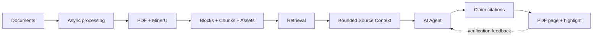

# Traceable RAG

<p align="center">
  
</p>

<p align="center">
  让 AI 智能体把关键陈述带回 PDF 原页，并准确高亮对应区域。
</p>

<p align="center">
  <a href="README.md">English</a>
  ·
  <a href="docs/getting-started.md">快速上手</a>
  ·
  <a href="docs/api.md">API</a>
  ·
  <a href="CONTRIBUTING.md">参与贡献</a>
</p>

<p align="center">
  <a href="LICENSE"></a>
  <a href="https://github.com/yo-solo/traceable-rag/actions/workflows/ci.yml"></a>
  
  
</p>

Traceable RAG 为 Codex 等外部 AI 智能体提供文档证据检索。它处理复杂版式文档，在指定知识库中返回 Source 候选，按需补充有限的相邻原文，并为每条结果提供稳定的核验页面。读者可以回到 PDF 原页，直接检查高亮区域。

服务端不负责撰写最终答案。问题拆解和内容组织仍由智能体完成，Traceable RAG 负责守住文档范围、检索过程和来源定位。


## 它解决什么问题

很多 RAG 演示给出一段看起来合理的回答，再附上文件名。严谨查询还需要多走一步，让读者能检查这句话究竟来自哪一页、哪一块原文。

- **陈述级核验**　每条有效候选都带 `source_url`，打开后可见原始页面和高亮区域。
- **有限上下文**　缺少定义、表头、单位或例外时，智能体只读取少量相邻内容。
- **版式感知处理**　PDF、DOCX 和常见图片经过异步转换、MinerU 解析、Block 归一化、Chunk 与资源整理。
- **降级状态可见**　接口会返回实际使用的检索管线。Embedding 或 Reranker 不可用时，调用方能看到结构化警告。
- **面向智能体的契约**　每次 Retrieval 只接收一个问题，知识库范围必须明确，Source 失效后返回清楚的 404 或 410。
- **本机安全默认值**　服务仅监听回环地址，容器使用非 root 用户，发布镜像固定 digest，Provider 密钥使用 AES-256-GCM 加密。

## Linux 快速启动

先准备 Git、Docker Engine 和 Docker Compose v2。首个公开 Release 发布前，源码部署是当前可验证的入口。

```bash
git clone https://github.com/yo-solo/traceable-rag.git
cd traceable-rag
./scripts/deploy_local.sh
```

健康检查通过后，打开 [http://127.0.0.1:8000](http://127.0.0.1:8000)。脚本会构建当前代码，按你的非 root UID/GID 启动容器，同时创建隔离数据目录和仅保留在本机的管理密钥、加密主密钥。

进入设置页配置 MinerU。Embedding 和 Reranker 可以按需配置。Provider 密钥由本人在浏览器中填写，加密后再持久化，不会写入部署环境文件。

随后创建知识库，上传 [`examples/vidore/documents`](examples/vidore/documents) 中的四份公开样例。它们来自取得明确授权的 ViDoRe 数据源节选，覆盖流程图、代码、跨页表格、双栏正文、脚注和统计图表。仓库没有放入现有项目的真实业务文档。

可以先问下面几题。

- 编译器分为哪些阶段，中端优化做什么
- 对照跨页表格，hierarchical inheritance 与 multiple inheritance 有什么区别
- 欧盟收入不平等在 2014 至 2015 年峰值以后怎样变化
- 面向未来的职业中，性别隔离在图表里呈现出什么特点

首个公开 `v0.5.0` Release 还会提供校验和安装器，以及发布在 `ghcr.io/yo-solo/traceable-rag-public` 的固定多架构镜像。Release 与 package 真正公开并完成验收以前，README 不把匿名安装链接写成已经可用的能力。

## 从问题走到原文

1. 智能体发现服务并选择一个或多个知识库。
2. 它把问题拆成明确的证据需求。
3. 它用 `auto` 或 `keyword` 调用 `POST /api/retrieval`。
4. 它分别判断候选是否相关、上下文是否完整。
5. 只有缺少具体信息时，它才调用 `GET /api/sources/{source_id}/context`。
6. 它把 Source 链接贴在所支撑的关键陈述附近。
7. 读者打开链接，核对 PDF 原页和高亮区域。

<details>
<summary>可复现的 Mermaid 架构图</summary>



</details>

## 两次调用完成核验

Retrieval 请求必须声明知识库范围。

```bash
curl -s http://127.0.0.1:8000/api/retrieval \
  -H 'Content-Type: application/json' \
  -d '{
    "query": "How did EU income inequality change after the 2014–15 peak?",
    "knowledge_base_ids": ["YOUR_KB_ID"],
    "mode": "auto",
    "top_k": 8
  }'
```

响应会给出 `pipeline_used`、降级状态、候选原文、文档名、从 1 开始的页码、排序分数，以及稳定的 `source_id` 和 `source_url`。分数用于候选排序，不能单独证明结论正确或证据充分。

确实缺少相邻信息时，再读取有限上下文。

```bash
curl -s 'http://127.0.0.1:8000/api/sources/SOURCE_ID/context?before=2&after=2'
```

当前公开契约是 Retrieval、可选的 Source Context 和 Source 链接。旧 `/api/query`、`/api/evidence/*`、`/api/traces/*` 会明确返回 404。

## Provider 边界

| 角色 | 用途 | 当前适配范围 | 失败后的行为 |
|---|---|---|---|
| MinerU | 解析上传文档 | MinerU 官方适配器 | 处理任务明确失败，可在修复配置后重试 |
| Embedding | 稠密检索与索引 | OpenAI-compatible 或 SiliconFlow | 条件允许时降级到关键词检索 |
| Reranker | 调整候选顺序 | SiliconFlow/Qwen、Cohere 或 Jina | 回退到稠密检索候选 |
| LLM | 可选诊断或外部流程 | OpenAI-compatible 或 SiliconFlow | 核心检索服务不依赖它 |

四个角色分别保存协议、Base URL、模型、密钥、选项和诊断状态。Embedding 配置变化会触发索引兼容性检查，服务不会悄悄复用不兼容向量。

## 已有验证

仓库包含后端契约、前端单元测试、浏览器 E2E、发布身份校验、安装器恢复测试和公开快照门禁。公开快照门禁会拦截旧私有样例路径及不应进入公开仓库的文件。

当前可复现检索结果来自 ViDoRe V3 Finance EN。评测使用 309 个问题、页级 qrels 和官方 `pytrec_eval` 口径。

| 管线 | nDCG@10 | Recall@10 | Recall@100 | MAP@10 |
|---|---|---|---|---|
| Traceable RAG 行组索引、query prompt 与 Qwen3 reranker | **0.5785** | **0.6451** | **0.8934** | **0.4564** |
| 使用相同 Embedding 的 page-dense 参考线 | 0.5523 | 0.6251 | 0.8785 | 0.4338 |

这些数字只描述固定的 Finance EN 检索实验。它们没有衡量答案正确率、全部 ViDoRe 领域、单独的 OCR 质量，也不能代表其他 Provider 配置。表格和图表的前排排序仍有已知回归。完整口径与限制记录在[基准报告](docs/benchmarks/vidore-finance-en.md)。

## 安全默认值

- 随附部署只监听 `127.0.0.1`，不会自动开放局域网或公网。
- Release 安装固定多架构镜像 digest，拒绝 `latest`。
- 容器使用非 root 用户，并启用 `no-new-privileges`。
- Provider 密钥使用 AES-256-GCM 加密，加密主密钥单独保存在宿主机。
- 管理设置需要本机 token，并检查可信 Host 与来源。
- 数据、配置、状态、备份、主密钥和管理 token 各自管理生命周期。
- 未知 Source 返回 404，因文档删除或重建而失效的 Source 返回 410。

准备开放本机以外的访问前，请先阅读 [`SECURITY.md`](SECURITY.md)。随附部署不支持非回环地址绑定。

## 当前范围

项目暂不提供内置聊天界面、服务端回答智能体、多智能体编排、MCP 或 Dify 兼容、隐藏思维过程存储，也不长期保存旧 Source 的历史版本。当前工作集中在文档处理、检索、有限上下文和原文核验。

## 代码目录

| 路径 | 职责 |
|---|---|
| `traceable_rag/` | FastAPI 服务、文档处理、检索、Provider 配置和 Source 生命周期 |
| `web/` | 知识库、检索调试、设置、API 参考和 PDF 核验页面 |
| `integrations/codex-skill/` | 智能体查询规则与 Source 引用流程 |
| `evaluation/vidore/` | 隔离、可复现的页级检索评测 |
| `examples/vidore/` | 有明确许可的公开节选及来源清单 |
| `deploy/` | 固定 digest 的 Compose 运行时和生命周期管理脚本 |
| `tests/` | 后端、发布、安装、安全和公开快照契约 |

## 文档入口

- [快速上手](docs/getting-started.md)
- [系统流程与架构](docs/architecture.md)
- [API 接口](docs/api.md)
- [开发与验收](docs/development.md)
- [部署与运维](docs/operations.md)
- [ViDoRe Finance EN 基准](docs/benchmarks/vidore-finance-en.md)
- [OpenAPI 快照](docs/openapi.json)
- [更新记录](CHANGELOG.md)

## 参与贡献与许可

欢迎提交边界清楚的问题和 Pull Request。开始前请阅读 [`CONTRIBUTING.md`](CONTRIBUTING.md) 和 [`CODE_OF_CONDUCT.md`](CODE_OF_CONDUCT.md)。安全问题请按 [`SECURITY.md`](SECURITY.md) 提供的方式报告。

源码与原创文档采用 [MIT License](LICENSE)。Traceable RAG 名称、Logo 与品牌资产另行受 [`TRADEMARKS.md`](TRADEMARKS.md) 约束。仓库附带的 ViDoRe 节选仍使用 CC BY 4.0，具体署名和依赖说明见 [`THIRD_PARTY_NOTICES.md`](THIRD_PARTY_NOTICES.md)。
