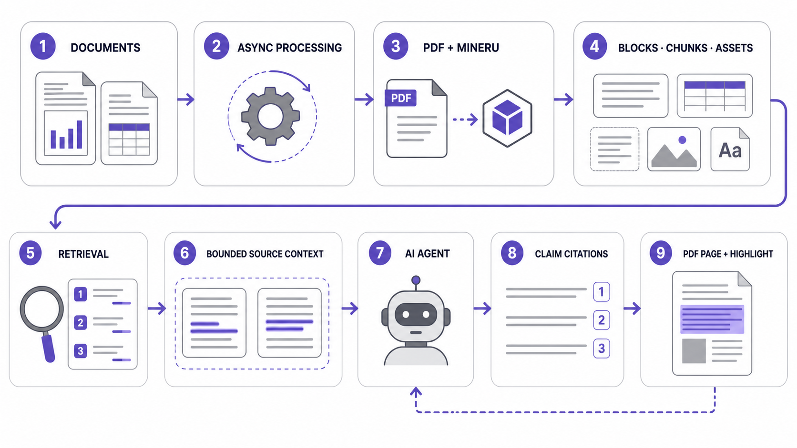

# 系统流程与架构

Traceable RAG 的核心不是服务端生成答案，而是为外部 AI Agent 提供可验证的文档检索与原文定位能力。

```mermaid
flowchart LR
    A["PDF / DOCX"] --> B["Document Processing Queue"]
    B --> C["PDF + MinerU"]
    C --> D["Blocks / Chunks / Index Records"]
    D --> E["Retrieval Service"]
    E --> F["Ranked Source candidates"]
    F --> G["Codex Skill evidence loop"]
    G --> H["Claim-level Source citations"]
    H --> I["Source verification page"]
    I --> J["PDF page + bbox highlight"]
```

## 数据层

- `KnowledgeBase`：检索隔离边界。
- `Document`：业务文件与处理状态。
- `Block`：按阅读顺序保存的原文、页码、bbox 和页面尺寸。
- `Chunk`：检索组织单元。
- `IndexRecord`：关键词/向量检索记录；表格可包含完整表格与行组视图。
- `SourceAnchor`：不暴露内部结构的当前版本原文定位符。

V3 SQLite schema 不保存回答历史、read events 或 Agent Trace。Source tombstone 不使用文档外键，因此文档删除或重建后仍能对旧链接返回明确的 410。

## Retrieval

`POST /api/retrieval` 一次只接受一个 query。多查询由 Codex 并行发起。

- `auto`：当前部署中经过评测的最佳检索管线；可能是 Dense 或 Dense + Reranker。
- `keyword`：条款号、原句、数字、标识符和专名。
- Reranker 失败时降级到 Dense。
- Embedding 不可用或索引不兼容时降级到关键词。
- 响应报告实际 `pipeline_used` 与结构化 warning，不判断证据是否足够回答。

内部检索目前仍复用 `EvidenceService` 作为候选生成实现；这是内部命名，不属于公开 Evidence API。

## Source

Retrieval 结果只向 Agent 暴露：

- `source_id` / `source_url`；
- 候选原文；
- 文档 ID 与业务文件名；
- 1-based 页码；
- bbox；
- 排序分数。

`GET /api/sources/{source_id}/context` 返回命中原文及有限的前后内容。它不返回整篇文档，也不暴露 Chunk/Block ID。

## Codex Agent loop

1. 确定知识库和比较文档集合。
2. 将问题拆成独立证据需求。
3. 为每个缺口生成单个明确 query。
4. 判断候选相关性。
5. 独立判断上下文完整性。
6. 仅在缺定义、例外、表头、单位或相邻条件时读取 Context。
7. 将需求标记为 `sufficient / partial / conflict / not_found`。
8. 只针对明确缺口进入下一轮。
9. 将 Source 链接贴近其支撑的关键陈述。

跨文档问题使用“证据需求 × 文档”的覆盖矩阵，不能用文件 A 的来源支撑文件 B 的结论。

## 前端

| 页面 | 路由 | 职责 |
|---|---|---|
| 知识库 | `/knowledge-bases` | 文档与队列管理 |
| 检索调试 | `/retrieval` | 检查候选、pipeline 与降级 |
| 设置 | `/settings` | 非敏感设置、运行诊断、Skill 接入 |
| Source | `/sources/{source_id}` | 原文优先、PDF 跳页与高亮 |

普通文档页只支持 `page` 和真实 `block` 参数。旧 `evidence`、`block_token` 参数会被移除；Agent 引用统一进入 Source 页面。

## 代码边界

| 模块 | 职责 |
|---|---|
| `document_processing.py` / `processing_jobs.py` | 异步处理与重试 |
| `retrieval.py` / `reranking.py` | 候选检索、去重与重排 |
| `evidence_service.py` | 内部 Retrieval orchestration |
| `source_service.py` | Source anchor、Context、404/410 |
| `sdk.py` | 新 Retrieval/Source Python SDK |
| `api_models.py` | 公开 HTTP 请求与响应 schema |
| `public_payload.py` | 公开 payload 投影与内部字段隔离 |
| `web_app.py` | FastAPI 路由编排与静态前端 |
| `integrations/codex-skill/traceable-rag` | Agentic 查询规则 |

## 明确边界

- 无内置聊天机器人或服务端 LLM Agent。
- 无多 Agent 编排。
- 无 Agent 搜索过程 Trace。
- 当前不维护 MCP 与 Dify。
- 无历史 Source 长期版本库；Source 只定位当前文档版本，失效后返回 410。
